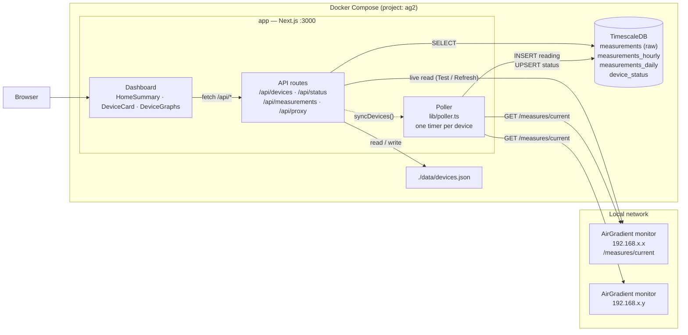

# Architecture

## Data flow

| What | Path |
|---|---|
| **Collection** | Poller → monitor `/measures/current` → `measurements` (history) + `device_status` (latest payload and health) |
| **Live tiles** | Browser → `/api/status` → `device_status`. This is what the poller last stored, so opening the dashboard adds no extra load on the monitors. |
| **Manual refresh / Test** | Browser → `/api/proxy` → monitor (live, not stored) |
| **Charts** | Browser → `/api/measurements?resolution=…` → raw, hourly or daily table depending on range |
| **Device changes** | `/api/devices*` writes `devices.json`, then calls `syncDevices()` so polling starts or stops right away |

## Chart resolution

| Range | Source | Bucket |
|---|---|---|
| 1H | raw | 15 s |
| 6H | raw | 90 s |
| 24H | raw | 5 min |
| 7D | hourly rollup | 30 min |
| 30D | hourly rollup | 2 h |
| 1Y / All | daily rollup | 1 day |

Retention: raw data is kept for 1 year, hourly rollups for 2 years, daily rollups for 10 years.

## Module map

| Module | Role |
|---|---|
| `lib/airgradient.ts` | The only code that talks to a monitor. Checks the address, times out after 10 s, blocks redirects, accepts only JSON, keeps only known fields. |
| `lib/addressValidation.ts` | Strict IPv4 parsing. Allows private ranges only (loopback is opt-in for development). |
| `lib/poller.ts` | Per-device timers, skips a poll if the previous one is still running, records success and failure. State lives on `globalThis` so API routes can resync it. |
| `lib/deviceStore.ts` | `devices.json` with a lock and atomic writes |
| `lib/status.ts` | Reads `device_status` and works out online/offline |
| `lib/airQualityThresholds.ts` | 5-level severity per metric, with indoor and outdoor comfort profiles |
| `lib/aqi.ts` | EPA PM2.5 → AQI conversion and labels |
| `lib/evaluate.ts` | A reading → per-metric status, plus the Air Quality and Comfort roll-ups |
| `lib/client.ts` | Browser-side API client |

## Design decisions

- **The browser never contacts monitors directly.** AirGradient's local API doesn't send
  CORS headers, and serving live tiles from `device_status` means ten open tabs don't
  turn into ten times the requests to a small ESP32.
- **Only the poller writes measurements.** The old app also inserted a row from every open
  browser tab, which duplicated data.
- **Bridge networking.** WeathAir needed `network_mode: host` for Tempest UDP broadcasts.
  AG2 only makes outbound HTTP requests, so the database stays private to the Compose network.
- **Private IPs only.** A device address is something the server will fetch, so it's
  restricted to private ranges to stop the app from being used to reach other hosts.
